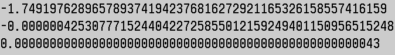

[](#english)
[](#russian)

[](https://github.com/Divetoxx/Mandelbrot-Video/releases/latest/download/Mandelbrot_windows_x64.zip )
[](https://github.com/Divetoxx/Mandelbrot-Video/releases/latest/download/Mandelbrot_linux_x64.tar.gz)
[](https://github.com/Divetoxx/Mandelbrot-Video/archive/refs/heads/main.zip)
[](https://github.com/Divetoxx/Mandelbrot-Video/archive/refs/heads/main.tar.gz)


<a name="english"></a>
# 🇺🇸 English Version

# Mandelbrot CLI: Renderer with Perturbation Theory and Bilinear approximation

## Credits & Acknowledgments

This project implements advanced orbit phase management paradigms and perturbation algorithms 
developed by the fractal research community. Special thanks to the following authors and pioneers 
from the Fractal Forums, whose collaborative work made this engine possible:
* **Kevin Martin** - for pioneering loop optimization and edge-case escape techniques.
* **Zhuoran Yu** - for developing the dynamic orbit re-basing paradigm.
* **Claude Heiland-Allen** - for extensive deep zoom research and the creation of the MDZ project.

## Key Features:

* **High-Precision Reference:** The 1000-bit reference trajectory is computed exactly once per zoom layer.
* **Hardware-Native Performance:** Blazing-fast math for billions of pixels utilizing hardware-native double registers.
* When using double-precision floating-point numbers (on the order of $10^{-15}$), perturbation theory only allows you to zoom down to the **$10^{-308}$ level-no further.**
* **Dynamic Reference Relocalization** (Orbit Re-basing).
* **Bilinear approximation:** The calculation can be performed significantly faster by using bilinear approximation.
* **True 8x8 SSAA:** Pristine, anti-aliased image quality with 64 independent samples per pixel.
* **Pure C++11 Multi-threading:** High-speed parallel computing built directly into the language standard.
* **Yes, this is FFmpeg**-the 'Swiss Army knife' of video processing.

## Arbitrary Precision Arithmetic (Infinite Depth)

The engine is completely free from the hardware limitations of standard 64-bit (`double`) and 128-bit (`__float128`) data types, 
which inevitably lose significance and produce pixelated blocks at depths beyond $10^{-15}$ and $10^{-34}$ respectively.
* **MPFR/GMP Integration**: All high-precision navigation, mouse clicking, and keyboard arrow zooming are handled within a deep binary memory 
structure configured to **1000-bit precision**.
* **308-Digit Decimal:** Viewport coordinates are stored in `Mandelbrot.txt`. While the MPFR 
reference radar computes the center at 1000-bit precision, the hardware native `double` exponent limits the fast pixel engine to a maximum 
depth of $10^{-308}$, providing pristine clarity up to this physical silicon barrier.


## Blazing Fast Perturbation Theory

Deep fractal rendering no longer requires heavy "long-division-style" arbitrary precision math for every individual pixel, which 
historically slowed down deep zoom software by thousands of times.
* **Single-Pass Reference Calculation**: The ultra-heavy MPFR BigFloat radar calculates the precise reference trajectory 
for **only one central pixel per frame and strictly ONCE** at the beginning of the render.
* **Hardware-Accelerated Double Math**: The rest of the viewport (billions of super-sampled pixels) is processed concurrently at the 
native speed of the CPU's hardware `double` registers, calculating only tiny deviations (deltas) from the central axis. 
This optimization boosts rendering speeds by up to 1000x!

## Dynamic Reference Relocalization (Orbit Re-basing)

This is a tremendous point of pride: the engine operates under the exact same mathematical and architectural principles 
as the world's most advanced Mandelbrot renderers.
*   **Dynamic Reset to Zero**: At every step, each pixel monitors the ratio of its absolute coordinates against its current delta. 
If the delta drifts too far or the primary reference orbit terminates, the execution thread dynamically 
**resets its tracking index to zero**, establishing the accumulated coordinates as a new autonomous origin 
and eliminating precision artifacts.
*   **One-Step Beyond Escape Loop Optimization**: To squeeze maximum performance out of the CPU, the MPFR reference 
tracker records exactly **one additional point** into the orbit array immediately after exceeding the escape radius. 
This precise boundary definition guarantees flawless orbit re-basing.
*   **Deep Loop Branch Optimization**: This elegant layout significantly streamlines conditions within the deepest 
iteration loop. By minimizing heavy branching and avoiding complex nested conditions where possible, the code improves 
branch prediction efficiency and allows the CPU pipeline to execute the core mathematics with maximum throughput.

## Bilinear Approximation

The computation can be performed significantly faster by utilizing Bilinear Approximation (BLA Skip-100). 
The code precomputes coefficient transformation matrices for steps of 100 iterations. If the current point is close 
enough to the reference orbit, the algorithm skips 100 iterations at once in a single mathematical step, minimizing the CPU load.


## Project Purpose

This is a high-end CLI workstation designed for the automated production of professional fractal video art. 
It manages the entire pipeline: from heavy-duty mathematical computations to the final assembly of the video 
file.

### Key Features:

*    **End-to-End Video Production**: The engine renders 255 high-precision frames, applies a smooth palette rotation, and automatically 
invokes FFmpeg to compile the final .mp4 video.
*    **Hardware-Aware Encoding**: The program detects your hardware to choose the best encoding strategy:
     - NVIDIA GPU detected: Uses h264_nvenc for ultra-fast hardware-accelerated encoding.
     - CPU only: Uses libx264 with professional-grade presets for maximum quality.
*    **Cinematic Quality (Full HD 1080p)**: Every video is rendered using SSAA 8x8 (64 Samples Per Pixel). This ensures that fine 
fractal details are perfectly reconstructed without the "sparkling" or aliasing artifacts common in digital video.
*    **Smart Cleanup**: Once the video is successfully compiled, the utility automatically deletes the temporary BMP 
frames (which can take up several gigabytes), leaving you only with the final Mandelbrot.mp4.

## Why use this?

*    **Content Generation**: Perfect for creating high-quality seamless loops for meditation videos, VJ sets, or motion backgrounds.
*    **Hardware Benchmark**: A unique hybrid workload that stresses the CPU with massive OpenMP parallel math and the GPU with video encoding.
*    **Full Automation**: No need to remember complex FFmpeg flags — just run the app, choose a location, and get a professional video file.
	
## Yes, this is FFmpeg-the 'Swiss Army knife' of video processing. 

In 2026, it remains the industry standard, 
powered by an open-source community. From YouTube and Netflix to professional movie studios, 
everyone relies on it. And yes, it's completely free.

## All-in-one: 

This repository already includes ffmpeg binaries for Windows and Linux. No manual installation is required!

## Pure C++11 Multi-threading

High-speed parallel computing built directly into the language standard. Scales transparently across architectures-delivering 
flawless 100% CPU utilization whether running on a 4-core laptop or a 128-core high-performance server without external dependencies.

## 8x8 Supersampling (64 Samples Per Pixel)

Super-Sampling Anti-Aliasing (SSAA) is a high-end technique increasing samples per pixel to enhance image quality, 
with 8x (N=8) rendering scenes at 8x resolution on both axes to produce 64 samples per pixel. 
This process calculates an extreme number of pixels-scaling to a 17280 x 17280 grid for a 2160 x 2160
target-before downscaling to remove jaggies and improve detail.

I decided to take the visual quality to a completely different level. This engine implements
True 8x8 Supersampling Anti-Aliasing (SSAA) with 64 independent samples per single screen pixel, utilizing Direct RGB-Space Integration.
Instead of a standard 2160x2160 render, the engine internally processes a massive 17280 x 17280 sub-pixel grid!
After calculating all 64 samples for a pixel, they are downsampled into one.
Key Technical Advantages:
*    64-Point Fractal Sampling: Each final screen pixel is computed from sixty-four independent fractal coordinate points.
*    High-Precision Per-Channel RGB Accumulation: The engine first calculates the specific 24-bit color for every single sub-pixel before performing any blending.
*    Noise Elimination: By accumulating color intensities (R, G, B) rather than raw iteration counts, we completely eliminate "chromatic noise." The result is a crystal-clear, razor-sharp image where every micro-filament is perfectly reconstructed.
*    True Color Integration: Our solution performs integration directly in the RGB color space. By computing the exact Red, Green, and Blue components for each sub-pixel before downsampling, we achieve a cinematic level of smoothness and structural integrity that 8-bit or iteration-based renderers simply cannot match.

## Generating 255 Frames: Optimization Strategy

This is an efficient pre-render strategy: we calculate the heavy mathematics (iteration counts) 
once, store the raw data, and then rapidly generate frames by shifting colors and downsampling.
Since calculating a 17280x17280 fractal 255 times is computationally expensive, we split the task into two stages.

### Stage 1: Iteration Map Generation (Raw Data)

Instead of BMP files, we create a single data buffer where we store only the iteration number (t) for each pixel.
*    For 17280x17280 using uint8_t, the resulting file/buffer is approximately 298 MB.

### Stage 2: 255-Frame Rendering (Color + Anti-aliasing)

We read the iteration map and perform the following for each frame:
*    Downsample: Process an 8x8 pixel block from the high-res map.
*    Color Mapping: Map each pixel value to a shifted color palette.
*    Smoothing: Average the colors (Supersampling Anti-Aliasing) to produce a final 2160x2160 frame.

### Why is this so fast?
*    Memory Efficiency: The iterMap array (~298 MB) easily fits into modern RAM. The heavy do-while calculation loop runs only once for the entire animation.
*    Palette Rotation: Stage 2 avoids long double arithmetic and squaring. It only involves integer addition and memory lookups.
*    Parallelism: Stage 2 is perfectly scalable. All 255 frames can be rendered simultaneously across CPU cores.
*    True Downsampling: We implement honest 8x8 averaging, resulting in superior image quality compared to simple resizing.
Once all 255 BMP files are generated, use FFmpeg to encode them into the final video.


## Visual Aesthetics

The Red, Green, and Blue channels are calculated using sine and cosine waves to create smooth color transitions:
```C++
        pal[a][0] = (uint8_t)round(127.0 + 127.0 * cos(2.0 * PI * a / 255.0)); // Blue
        pal[a][1] = (uint8_t)round(127.0 + 127.0 * sin(2.0 * PI * a / 255.0)); // Green
        pal[a][2] = (uint8_t)round(127.0 + 127.0 * sin(2.0 * PI * a / 255.0)); // Red
```

## License and Third-Party Software

### My Code

This project is licensed under the **MIT License**.

### FFmpeg

This software uses libraries from the **FFmpeg** project under the **LGPLv2.1** (or GPLv3, depending on the build). 
*   FFmpeg is a trademark of Fabrice Bellard, originator of the FFmpeg project.
*   You can find the source code and more information at [https://ffmpeg.org](https://ffmpeg.org).
*   The FFmpeg binaries included in the releases are provided as-is, and no modifications have been made to the FFmpeg source code.


## The Mandelbrot Set: A Mathematical Absolute

It is truly one of the few objects that connects us to something absolutely objective and infinite, 
transcending biology and history. Even if our entire universe and all its atoms were to vanish tomorrow, 
the equation would remain true. It is not "written" on the stars; it is embedded in the structure of logic itself. 
This makes the Mandelbrot Set a kind of absolute.

The Mandelbrot set exists independently of our minds and technology. It is an infinite mathematical structure that 
has always existed.


## Controls & Automation (CLI)

The program operates on a "one-click" principle: you select the location, and the rest (calculation, encoding, cleanup) happens automatically.

| Action | Input | Description |
| :--- | :--- | :--- |
| **Presets** | `1` - `9` + `ENTER` | Choose one of the 9 built-in deep-zoom cinematic locations. |
| **Custom Point** | `0` + `ENTER` | Load custom coordinates (`absc`, `ordi`, `size`) from `Mandelbrot.txt`. |
| **Rendering** | **Step 1 (Auto)** | High-precision calculation of 255 frames using **Multi-threading** and **SSAA 8x8**. |
| **Encoding** | **FFmpeg** | **Portable Mode**: The app automatically detects `ffmpeg` in the local folder. Automatic frame-to-MP4 compilation (30 FPS). |
| **Cleanup** | **Auto** | Automatic deletion of temporary BMP files after the video is finished. |


## Mandelbrot.txt File Structure

To load custom coordinates (option 8 in the menu), create a Mandelbrot.txt file in the application folder. 
The file must contain three numbers separated by a newline:
*    Abscissa (Center X coordinate)
*    Ordinate (Center Y coordinate)
*    Size (Zoom level/Area size)

Example file content:



## Look at the results! The smoothness is incredible 

```C++
case 1: absc_str = "-1.74919762896578937419423768162729211653261585574161734756645570271259437106847945278504682550816934045282325615313706"; 
ordi_str = "-0.0000004253077715244042272585501215924940115095651514128365051648578746521975467051762910002043554114332125868777767"; 
size_str = "1.34e-113"; break;
```
https://github.com/user-attachments/assets/bf4c67c9-48e7-4b1e-b855-a6b27e449481

```C++
case 2: absc_str = "-1.74907816150520173167912454515663360420734509948112463480292338384"; 
ordi_str = "-0.00000550991906629096602513098567268615714673236269915508056068145"; 
size_str = "1.53e-62"; break;
```
https://github.com/user-attachments/assets/019a873e-55bb-4616-a92a-cf9825672798

```C++
case 3: absc_str = "-1.7489436617686633372073552153211507258063533373824414679761"; 
ordi_str = "-0.0000073748967541889836640985849393311615399776865199722998"; 
size_str = "1.01e-55"; break;
```
https://github.com/user-attachments/assets/1111a250-20d9-46f7-8d87-e4ea843c48d5

```C++
case 4: absc_str = "-1.7491311840575335110236048528001036247123430447933925298694915282522178938437759580179"; 
ordi_str = "-0.001996960702541036804654299663680287246637758588467627907752429037173153157138373325"; 
size_str = "2.84e-82"; break;
```
https://github.com/user-attachments/assets/ec5accfe-b53e-48d6-a971-10af14999527

```C++
case 5: absc_str = "-1.74994586497557459407526067070055710001"; 
ordi_str = "-0.0000000852088539604644334731909824511"; 
size_str = "7.17e-36"; break;
```
https://github.com/user-attachments/assets/545b722a-a2a5-4ec2-ba5c-8a5c9d052a32

```C++
case 6: absc_str = "-1.267078059171397835210199054200436920994876769284288837862647"; 
ordi_str = "-0.123788215196292957558264285607075473360968832625384429809391"; 
size_str = "2.4e-57"; break;
```
https://github.com/user-attachments/assets/37a76cb8-992b-4d08-84dd-c8b5138eec1a

```C++
case 7: absc_str = "-1.99999543561201124623198345433951143502785679245726844745821388800402678499411681518036306219179273434395557574279985918047221291197081186140687781560831995";
ordi_str = "-0.00000000000000000000000026198152173811047783694060060607013913873144250985383083459221663448338433592617272786772587281530484110756597337683912309313885172";
size_str = "1.15e-119"; break;
```
https://github.com/user-attachments/assets/74aa5a47-8197-4c16-a7c5-4bffc1204ea0

```C++
case 8: absc_str = "-0.843233764530751513324611730003844788663891317894291476942";
ordi_str = "0.223818041558069959139898295480311440395574821870538878074";
size_str = "2.66e-52"; break;
```
https://github.com/user-attachments/assets/14efdbea-797f-420d-9694-72625f2b0e0a

```C++
case 9: absc_str = "-0.12702288604303376058504940552835636145639339878096842408417373730142";
ordi_str = "-0.98728474138900681012772182210671973643707041031463043446236865072278";
size_str = "6.18e-64"; break;
```
https://github.com/user-attachments/assets/d104f654-a498-4ff7-a9db-d48dd0f98c61


**[Download Latest Version (Windows & Linux)](https://github.com/Divetoxx/Mandelbrot-Video/releases)**


# 🇷🇺 Русская версия
<a name="russian"></a>

# Консольный рендерер Мандельброта с методом возмущений и билинейную аппроксимацию.

## Благодарности (Credits)

Этот проект использует передовые математические алгоритмы и идеи динамического управления фазой орбит, 
разработанные фрактальным сообществом. Особая благодарность авторам и исследователям с Fractal Forums, 
чей совместный труд лег в основу этого движка:
* **Kevin Martin** - автор фундаментальных методов векторизации и оптимизации циклов возмущений.
* **Zhuoran Yu** - разработчик концепции динамического сброса орбит.
* **Claude Heiland-Allen** - исследователь экстремального фрактального приближения и создатель проекта MDZ.

## Ключевые особенности:

* Расчёт опорной траектории на 1000 бит всего один раз.
* Реактивный расчёт миллиарда пикселей на аппаратном double.
* При использовании чисел с плавающей запятой двойной точности (порядка $10^{-15}$) теория возмущений позволяет приблизиться к уровню **$10^{-308}$ - не дальше.**
* Динамическая релокализация опорной точки (Перебазирование орбиты).
* Расчет можно выполнить существенно быстрее, если использовать билинейную аппроксимацию.
* Настоящий SSAA 8x8 для идеально сглаженного изображения без алиасинга.
* Многопоточность на чистом C++11 (Pure C++11 Multi-threading).
* Да, это FFmpeg - "швейцарский армейский нож" для обработки видео.

## Безграничная точность (Arbitrary Precision Arithmetic)

Движок полностью избавлен от аппаратных ограничений 64-битных (`double`) и 128-битных (`__float128`) чисел, которые неизбежно слепнут и выдают 
пиксельные квадраты на глубинах более $10^{-15}$ и $10^{-34}$.
* **Интеграция MPFR/GMP**: Вся высокоточная навигация, пересчёт масштаба при кликах мыши и движении стрелочками клавиатуры ведутся 
внутри сверхглубокой бинарной памяти с точностью **1000 бит**!
* **308 десятичных знаков**: 
Координаты кадра сохраняются и считываются из файла `Mandelbrot.txt`. Навигация и радар MPFR работают на глубине до 1000 бит, 
однако скоростной пиксельный дельта-движок ограничен аппаратной экспонентой `double`, что позволяет исследовать безупречно четкие 
структуры на запредельных масштабах **вплоть до $10^{-308}$ знаков**.


## Реактивный метод возмущений (Perturbation Theory)

Рендеринг глубоких фракталов больше не требует тяжелых вычислений <в столбик> для каждого пикселя, что обычно замедляло программы в тысячи раз.
* **Однократный расчёт опоры**: Сверхтяжелый BigFloat-радар MPFR вычисляет точную траекторию всего для **одной-единственной центральной точки 
кадра и строго ОДИН раз** в начале рендеринга.
* **Аппаратное ускорение на double**: Весь остальной массив экрана (миллиарда супер-пикселей) рассчитывается параллельно на бешеной скорости 
чистых, аппаратных регистров `double` процессора, вычисляя лишь микроскопические отклонения (дельты) от центральной оси. 
Скорость генерации взлетела в 1000 раз!

## Динамическая релокализация опорной точки (Перебазирование орбиты)

Это предмет особой гордости: движок работает на тех же математических и архитектурных принципах, 
что и самые продвинутые рендереры Мандельброта в мире.
*     Динамический сброс в ноль (Dynamic Reset to Zero): На каждом шаге для каждого пикселя отслеживается соотношение его абсолютных 
координат и текущего отклонения (дельты). Если дельта уходит слишком далеко или основная опорная орбита завершается, поток 
вычислений динамически сбрасывает индекс отслеживания в ноль. Это превращает накопленные координаты в новое автономное начало 
отсчета и полностью устраняет артефакты точности.
*     Оптимизация цикла <На один шаг за предел ухода> (One-Step Beyond Escape Loop Optimization): Чтобы выжать максимум производительности 
из CPU, трекер опорной орбиты MPFR записывает ровно одну дополнительную точку в массив орбиты сразу после того, как она превышает 
радиус ухода (escape radius). Такое точное определение границы гарантирует безупречное перебазирование орбиты.
*     Оптимизация ветвлений в глубоком цикле (Deep Loop Branch Optimization): Эта элегантная структура кода существенно упрощает 
условия внутри самого глубокого цикла итераций. Минимизируя тяжелые ветвления и избегая сложных вложенных условий там, где это 
возможно, код повышает эффективность предсказателя ветвлений процессора и позволяет конвейеру CPU выполнять базовые математические 
расчеты с максимальной пропускной способностью.

## Билинейную аппроксимацию

Расчет можно выполнить существенно быстрее, если использовать билинейную аппроксимацию (BLA Skip-100). 
Код предварительно рассчитывает матрицы трансформации коэффициентов для шагов по 100 итераций. 
Если текущая точка находится достаточно близко к опорной орбите, алгоритм <перепрыгивает> сразу 100 итераций 
за один математический шаг, минимизируя нагрузку на CPU.


## О проекте

Это консольная станция для автоматизированного создания профессионального видео-арта на основе множества Мандельброта. 
Программа берет на себя весь цикл производства: от тяжелых математических вычислений до финальной сборки готового видеофайла.

### Что делает эта программа:
*    **Полный цикл видеопроизводства**: Программа рассчитывает 255 кадров фрактала, применяет эффект плавной ротации палитры и автоматически 
вызывает FFmpeg для сборки видео в формате .mp4.
*    **Интеллектуальный рендеринг**: Программа сама определяет наличие видеокарты NVIDIA.
     - Если есть GPU — используется аппаратное ускорение h264_nvenc для мгновенного сжатия.
     - Если видеокарта не найдена — используется профессиональный CPU-кодировщик libx264 с глубокой оптимизацией.
*    **Кинематографическое качество (Full HD 1080p)**: Каждое видео создается с использованием SSAA 8x8. Это значит, что для каждого 
кадра выполняется в 64 раза больше вычислений, чем обычно, чтобы полностью исключить мерцание и шум в видео.
*    **Автоматическая очистка**: После успешной сборки видео программа сама удаляет промежуточные BMP-файлы (которые могут 
занимать гигабайты), оставляя вам только готовый результат Mandelbrot.mp4.

## Для чего это нужно:
*    **Генерация контента**: Создание идеальных зацикленных (loop) фонов для медитации, VJ-сетов или YouTube-каналов.
*    **Демонстрация мощи железа**: Проект сочетает интенсивные вычисления на CPU (OpenMP) и скоростное кодирование на GPU.
*    **Удобство**: Вам не нужно знать команды командной строки FFmpeg — программа всё сделает за вас. 

## Да, это FFmpeg - "швейцарский армейский нож" для обработки видео.

В 2026 году он остается отраслевым стандартом, 
поддерживаемым сообществом разработчиков открытого программного обеспечения. 
От YouTube и Netflix до профессиональных киностудий - все на него полагаются. И да, он совершенно бесплатный.

## Всё включено: 

Этот репозиторий уже содержит исполняемые файлы ffmpeg для Windows и Linux. Никакой ручной установки не требуется - всё работает прямо <из коробки>!


## Многопоточность на чистом C++11 (Pure C++11 Multi-threading)

Высокоскоростные параллельные вычисления, встроенные напрямую в стандарт языка. 
Алгоритм прозрачно масштабируется на любые архитектуры, обеспечивая безупречную 
100%-ю загрузку процессора как на 4-ядерном ноутбуке, так и на 128-ядерном 
высокопроизводительном сервере - абсолютно без внешних зависимостей.


## Суперсэмплинг 8x8 (64 прохода на один пиксель)

Суперсэмплинг (SSAA) - ресурсоемкий метод сглаживания, увеличивающий число выборок на пиксель для повышения качества изображения. 
При значении 8x (N=8) сцена рендерится в разрешении, в 8 раз превышающем целевое, по обеим осям, создавая 64 (или 8 х 8) выборки 
на пиксель. Изображение просчитывается в более высоком разрешении, а затем принудительно уменьшается до разрешения дисплея, 
устраняя лесенки и улучшая чёткость. Это очень высокая нагрузка! Это не 2160 на 2160 пикселя а в 8x8 больше - 17280 на 17280 пикселя!

Я решил вывести качество изображения на совершенно новый уровень. Этот движок использует
истинное сглаживание 8x8 Supersampling Anti-Aliasing (SSAA) с 64 независимыми сэмплами на каждый пиксель экрана, используя прямую интеграцию в RGB-пространство.
Вместо стандартного рендеринга 2160x2160, движок обрабатывает внутри себя огромную сетку из 17280 x 17280 субпикселей!

После вычисления всех 64 сэмплов для пикселя, они уменьшаются до одного.
Ключевые технические преимущества:
*   64-точечное фрактальное сэмплирование: каждый конечный пиксель экрана вычисляется из шестидесяти четырех независимых 
фрактальных координатных точек.
*   Высокоточное накопление RGB-цвета по каналам: движок сначала вычисляет конкретный 24-битный цвет для каждого субпикселя, 
прежде чем выполнять какое-либо смешивание.
*   Устранение шума: Накапливая интенсивность цвета (R, G, B), а не просто подсчитывая количество итераций, мы полностью 
устраняем <хроматический шум>. В результате получается кристально чистое, резкое изображение, где каждая микронить идеально воссоздана.
*   Интеграция истинного цвета: Наше решение выполняет интеграцию непосредственно в цветовом пространстве RGB. 
Вычисляя точные компоненты красного, зеленого и синего цветов для каждого субпикселя перед понижением разрешения, 
мы достигаем кинематографического уровня плавности и структурной целостности, недостижимого для 8-битных или итерационных рендеров.


## Генерация 255 кадров

Это отличная стратегия оптимизации! Вы хотите применить пререндер: сначала рассчитать тяжелую математику (номера итераций) один раз, сохранить их, а затем быстро генерировать кадры, просто меняя цвета и уменьшая размер.
Поскольку считать 17280x17280 255 раз - это безумие, мы разделим задачу на два этапа.

### Этап 1: Генерация <карты итераций> (Raw Data)
Вместо BMP мы создадим один огромный файл, где для каждого пикселя запишем только число t (номер итерации). 
Для 17280x17280 при использовании uint8_t файл займет около 298 МБ.

### Этап 2: Генерация 255 кадров (Цвет + Сглаживание)
Теперь мы читаем эту карту и для каждого кадра делаем:
Берем блок 8x8 пикселей из большой карты.
Красим каждый пиксель согласно сдвинутой палитре.
Усредняем цвета (это и есть сглаживание) и записываем в файл 2160x2160.

### Почему это сработает быстро?
*    **Память**: Массив iterMap занимает около 298 МБ. Это легко помещается в современную оперативную память. Тяжелый цикл do-while выполняется только один раз для всей анимации.
*    **Вращение палитры**: В этапе 2 нет long double, нет возведения в квадрат. Только сложение целых чисел и чтение из памяти.
*    **Параллелизм**: Этап 2 тоже идеально распараллеливается. 255 кадров будут вылетать очень быстро. Реализован честный Downsampling. Мы берем блок 8x8 и усредняем их. 
Когда у вас будет 255 файлов bmp, используйте ffmpeg, чтобы собрать их в видео.


## Визуальная эстетика

Красный, зеленый и синий каналы рассчитываются с использованием синусоидальных и косинусоидальных волн для создания плавных цветовых переходов:
```C++
        pal[a][0] = (uint8_t)round(127.0 + 127.0 * cos(2.0 * PI * a / 255.0)); // Blue
        pal[a][1] = (uint8_t)round(127.0 + 127.0 * sin(2.0 * PI * a / 255.0)); // Green
        pal[a][2] = (uint8_t)round(127.0 + 127.0 * sin(2.0 * PI * a / 255.0)); // Red
```

## Лицензия и стороннее программное обеспечение

### Мой код

Этот проект распространяется под лицензией **MIT**.

### FFmpeg

Это программное обеспечение использует библиотеки из проекта **FFmpeg** под лицензией **LGPLv2.1** (или GPLv3, в зависимости от сборки).
* FFmpeg является товарным знаком Фабриса Беллара, создателя проекта FFmpeg.
* Исходный код и дополнительную информацию можно найти по адресу [https://ffmpeg.org](https://ffmpeg.org).
* Бинарные файлы FFmpeg, включенные в релизы, предоставляются как есть, и в исходный код FFmpeg не вносились никакие изменения.


## Множество Мандельброта: Математический абсолют

Это поистине один из немногих объектов, который связывает нас с чем-то абсолютно объективным и бесконечным,
превосходящим биологию и историю. Даже если бы вся наша Вселенная и все её атомы исчезли завтра,
уравнение осталось бы верным. Оно не <написано> на звёздах; оно заложено в самой структуре логики.
Это делает множество Мандельброта своего рода абсолютом.

Множество Мандельброта существует независимо от нашего разума и технологий. 
Это бесконечная математическая структура, которая существовала всегда.

## Управление и автоматизация (CLI & Automation)

Программа работает по принципу <одной кнопки>: вы выбираете локацию, а остальное (расчет, кодирование, очистка) происходит автоматически.

| Действие | Ввод | Описание |
| :--- | :--- | :--- |
| **Выбор локации** | `1` - `9` + `ENTER` | Выбор одной из 9 встроенных точек мандельброта - глубокого зума. |
| **Свои координаты** | `0` + `ENTER` | Загрузка координат (`absc`, `ordi`, `size`) из файла `Mandelbrot.txt`. |
| **Рендеринг (Авто)** | **Шаг 1** | Расчет 255 кадров с использованием **Многопоточность** и **SSAA 8x8**. |
| **Сборка (Авто)** | **FFmpeg** | **Portable Mode**: Программа сама найдет `ffmpeg` в своей папке. Автоматическое кодирование в MP4 (30 FPS). |
| **Очистка** | **Авто** | Удаление временных кадров после успешного создания видео. |


## Структура файла Mandelbrot.txt

Для загрузки пользовательских координат (пункт 8 в меню), создайте текстовый файл Mandelbrot.txt в папке с программой. 
Файл должен содержать три числа, разделенных переносом строки:
*    Abscissa (Координата X центра)
*    Ordinate (Координата Y центра)
*    Size (Масштаб/Размер области)

Пример содержания файла:


## Посмотрите на результаты! Невероятная плавность работы


```C++
case 1: absc_str = "-1.74919762896578937419423768162729211653261585574161734756645570271259437106847945278504682550816934045282325615313706"; 
ordi_str = "-0.0000004253077715244042272585501215924940115095651514128365051648578746521975467051762910002043554114332125868777767"; 
size_str = "1.34e-113"; break;
```
https://github.com/user-attachments/assets/bf4c67c9-48e7-4b1e-b855-a6b27e449481

```C++
case 2: absc_str = "-1.74907816150520173167912454515663360420734509948112463480292338384"; 
ordi_str = "-0.00000550991906629096602513098567268615714673236269915508056068145"; 
size_str = "1.53e-62"; break;
```
https://github.com/user-attachments/assets/019a873e-55bb-4616-a92a-cf9825672798

```C++
case 3: absc_str = "-1.7489436617686633372073552153211507258063533373824414679761"; 
ordi_str = "-0.0000073748967541889836640985849393311615399776865199722998"; 
size_str = "1.01e-55"; break;
```
https://github.com/user-attachments/assets/1111a250-20d9-46f7-8d87-e4ea843c48d5

```C++
case 4: absc_str = "-1.7491311840575335110236048528001036247123430447933925298694915282522178938437759580179"; 
ordi_str = "-0.001996960702541036804654299663680287246637758588467627907752429037173153157138373325"; 
size_str = "2.84e-82"; break;
```
https://github.com/user-attachments/assets/ec5accfe-b53e-48d6-a971-10af14999527

```C++
case 5: absc_str = "-1.74994586497557459407526067070055710001"; 
ordi_str = "-0.0000000852088539604644334731909824511"; 
size_str = "7.17e-36"; break;
```
https://github.com/user-attachments/assets/545b722a-a2a5-4ec2-ba5c-8a5c9d052a32

```C++
case 6: absc_str = "-1.267078059171397835210199054200436920994876769284288837862647"; 
ordi_str = "-0.123788215196292957558264285607075473360968832625384429809391"; 
size_str = "2.4e-57"; break;
```
https://github.com/user-attachments/assets/37a76cb8-992b-4d08-84dd-c8b5138eec1a

```C++
case 7: absc_str = "-1.99999543561201124623198345433951143502785679245726844745821388800402678499411681518036306219179273434395557574279985918047221291197081186140687781560831995";
ordi_str = "-0.00000000000000000000000026198152173811047783694060060607013913873144250985383083459221663448338433592617272786772587281530484110756597337683912309313885172";
size_str = "1.15e-119"; break;
```
https://github.com/user-attachments/assets/74aa5a47-8197-4c16-a7c5-4bffc1204ea0

```C++
case 8: absc_str = "-0.843233764530751513324611730003844788663891317894291476942";
ordi_str = "0.223818041558069959139898295480311440395574821870538878074";
size_str = "2.66e-52"; break;
```
https://github.com/user-attachments/assets/14efdbea-797f-420d-9694-72625f2b0e0a

```C++
case 9: absc_str = "-0.12702288604303376058504940552835636145639339878096842408417373730142";
ordi_str = "-0.98728474138900681012772182210671973643707041031463043446236865072278";
size_str = "6.18e-64"; break;
```
https://github.com/user-attachments/assets/d104f654-a498-4ff7-a9db-d48dd0f98c61


**[Скачать последнюю версию (Windows и Linux)](https://github.com/Divetoxx/Mandelbrot-Video/releases)**


